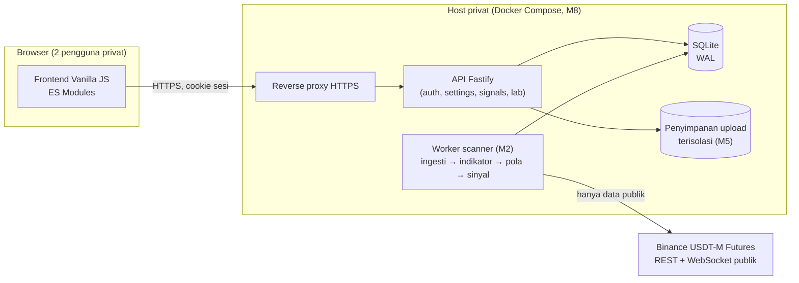
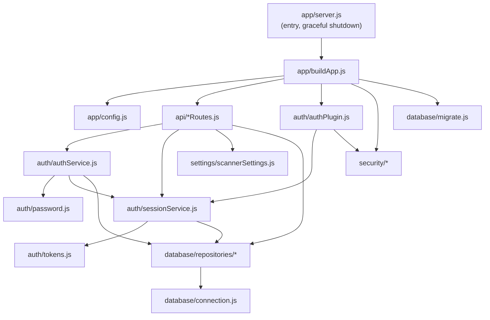
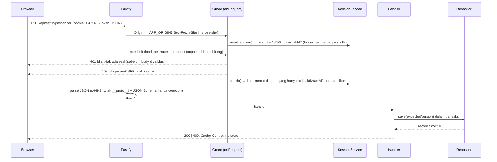

# 01 — Arsitektur

## 1. Prinsip

1. **Modular monolith** — satu proses API + satu proses worker (mulai M2), berbagi kode domain. Tanpa microservice (ADR-0001).
2. **Logika bisnis terpisah** dari HTTP handler dan persistensi: `api/` tipis → service → repositori.
3. **Dependency injection eksplisit** — `buildApp({ config, db, clock })` merakit semua dependensi; tes memakai jam deterministik dan database in-memory.
4. **Secure by default** — setiap route `/api/*` wajib terautentikasi kecuali ditandai `public`.
5. **Kejujuran data** — UI tidak pernah menampilkan data pasar contoh. Komponen yang belum dibangun berstatus `not_implemented`.
6. **Waktu UTC** — semua timestamp disimpan sebagai epoch milidetik UTC.

## 2. Gambaran sistem (target)

Milestone 1 mengimplementasikan: Frontend shell, API Fastify, autentikasi, pengaturan, status sistem, dan skema database. Worker, Binance, mesin pola, lab, dan backtest menyusul sesuai roadmap.

## 3. Struktur modul & arah dependensi

Aturan: modul di bawah tidak boleh mengimpor modul di atasnya; tidak ada impor melingkar. Repositori adalah satu-satunya tempat SQL ditulis.

Modul yang direncanakan dan posisinya:

| Modul | Milestone | Bergantung pada |
|---|---|---|
| `backend/ingestion/` (klien Binance, validasi candle, backfill) | 2 | repositori `candles`, `symbols` |
| `worker/` (loop scanner, jadwal, metrik) | 2 | ingestion, indicators, patterns |
| `backend/indicators/` (EMA, ATR, RVOL, swing) — fungsi murni | 3 | — |
| `backend/patterns/` (SA, PVA, evaluator aturan deklaratif) | 3 | indicators |
| `backend/timeframe/` (trend classifier, timeframe resolver) | 3 | indicators |
| `backend/scoring/`, `backend/signals/` (state machine) | 3 | patterns, timeframe |
| `backend/backtest/` (replay deterministik) | 6 | patterns, signals (mode replay) |

Fungsi indikator & pola akan murni (input candle tertutup → output), sehingga worker live dan backtest memakai kode yang sama — mencegah perbedaan perilaku live vs replay.

## 4. Alur request terautentikasi

Gerbang autentikasi, rate limit, dan header `no-store` memutuskan berdasarkan **pola route yang cocok** (`request.routeOptions.url`), bukan `request.url` mentah. Router Fastify mendekode path (`/%61pi/overview` → `/api/overview`) dan membuang prefix absolute-form (`GET http://host/api/...`), sehingga pemeriksaan prefix pada URL mentah dapat dilewati (temuan review mandiri M1, regresi `SEC-RT-*`). Gerbang dipasang per route lewat hook `onRoute`; route `/api/*` yang terdaftar tanpa gerbang ditolak (fail closed), dan path `/api/*` yang tidak dikenal ditangkap route catch-all agar tetap melewati gerbang.

## 5. Frontend

- **Tanpa framework dan tanpa bundler** — ES Modules native dimuat langsung oleh browser (ADR-0005).
- `index.html` hanya disajikan oleh route `/` setelah sesi diverifikasi di server; tanpa sesi → redirect `/login.html`.
- Router hash (`#/overview`, …) dengan satu modul view per layar di `frontend/js/views/`.
- Semua render melalui `h()` (`js/lib/dom.js`) yang memakai `textContent` — `innerHTML` dilarang oleh ESLint dan Semgrep.
- Token CSRF disimpan di memori modul `api.js`, bukan di Web Storage. `localStorage` hanya untuk preferensi UI (sidebar diciutkan).
- CSP `script-src 'self'; style-src 'self'` — tidak ada script/style inline. Nilai dinamis (lebar bar skor) diset lewat CSSOM (`style.setProperty`) yang diizinkan CSP.

## 6. Konfigurasi & operasi

- Konfigurasi hanya dari environment (`config/.env.example`), divalidasi saat startup. Produksi wajib `APP_ORIGIN` https, cookie `Secure`, dan `DATABASE_PATH` eksplisit — bila tidak, proses berhenti.
- `GET /api/health` (liveness) dan `GET /api/ready` (cek database) publik dengan respons minimal.
- `SIGTERM`/`SIGINT` → `app.close()` (berhenti menerima request, 503 saat closing) → tutup database; paksa keluar setelah 10 detik.
- Log terstruktur JSON (pino) dengan redaksi header `cookie`, `x-csrf-token`, dan `set-cookie`.
- Sesi kedaluwarsa dibersihkan setiap 15 menit.

## 7. Jalur migrasi ke PostgreSQL

- Repositori berkontrak async — pemanggil sudah `await`, sehingga driver async (`pg`) dapat menggantikan tanpa mengubah service.
- SQL dijaga mendekati standar: `INTEGER` epoch ms → `BIGINT`, `STRICT`/`WITHOUT ROWID` dihapus, `json_valid()` → kolom `JSONB`, `COLLATE NOCASE` → `CITEXT` atau indeks `lower()`.
- Migrasi berupa file SQL bernomor dengan checksum; untuk PostgreSQL disiapkan direktori migrasi paralel.
