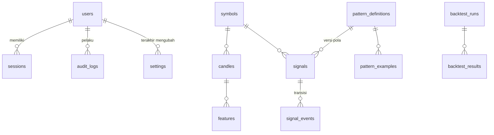

# 05 — Database

SQLite melalui `better-sqlite3`, mode WAL, `foreign_keys=ON`, `busy_timeout=5000`. Semua tabel `STRICT` (tipe kolom ditegakkan). Timestamp = `INTEGER` epoch milidetik UTC.

## 1. Migrasi

- File `backend/database/migrations/NNN_nama.sql`, nomor wajib berurutan mulai `001`.
- Tabel `schema_migrations(version, name, checksum, applied_at)` mencatat migrasi yang diterapkan.
- Setiap migrasi berjalan dalam satu transaksi — gagal di tengah berarti rollback penuh (tes `EDGE-DB-001`).
- Checksum SHA-256 migrasi yang sudah diterapkan diverifikasi setiap startup; file yang diubah setelah diterapkan menghentikan aplikasi (`NEG-DB-001`). **Perubahan skema selalu lewat migrasi baru.**
- Dijalankan otomatis saat server start dan manual via `npm run migrate`.

## 2. Diagram entitas

## 3. Tabel — 001 inti (dipakai di M1)

### `users`
| Kolom | Keterangan |
|---|---|
| `username` | Unik, `COLLATE NOCASE`, 3–32 karakter |
| `password_hash` | `CHECK` harus diawali `$argon2id$` |
| `role` | `admin` \| `analyst` |
| `totp_secret` | Disiapkan untuk MFA (M7) |
| `failed_login_count`, `locked_until` | Penguncian akun |

### `sessions`
| Kolom | Keterangan |
|---|---|
| `token_hash` | SHA-256 hex dari token cookie (token mentah tidak disimpan), unik |
| `csrf_token` | Token CSRF per sesi |
| `idle_expires_at`, `expires_at` | Kedaluwarsa idle (sliding) & absolut |
| `revoked_at`, `revoke_reason` | `logout`, `replaced`, `revoked_by_user` |

Indeks: `(user_id, revoked_at, expires_at)`, `(expires_at)`.

### `settings`
`key` (PK), `value_json` (`CHECK json_valid`), `version` (optimistic concurrency), `updated_by`, `updated_at`.

### `audit_logs`
Append-only: `occurred_at`, `user_id`, `action`, `outcome` (`success|failure`), `ip_address`, `detail_json`. Tidak pernah menyimpan kata sandi atau token. Aksi M1: `auth.login`, `auth.logout`, `auth.account_locked`, `auth.session_revoked`, `auth.sessions_revoked`, `settings.scanner.update`, `user.create`.

## 4. Tabel — 002 domain (draf, mulai dipakai M2–M6)

| Tabel | Kunci & constraint penting |
|---|---|
| `symbols` | `symbol` unik `GLOB '[A-Z0-9]*'`; `is_monitored`; `delisted_at` untuk simbol yang dihapus Binance |
| `candles` | **PK kanonik `(symbol_id, timeframe, open_time)`**, `WITHOUT ROWID`; timeframe ∈ {5m,15m,1h}; `CHECK` konsistensi OHLC (high ≥ open/close/low, low ≤ open/close), harga > 0, volume ≥ 0, `close_time > open_time`; `is_closed`; `source` ∈ {rest, ws} |
| `features` | PK `(symbol_id, timeframe, open_time, feature_set)`, FK ke candle; `values_json` |
| `pattern_definitions` | Unik `(pattern_key, version)`; status `draft → review → validated → active → retired` |
| `pattern_examples` | Label `positive|negative`, rentang candle, waktu deteksi yang diinginkan, hash gambar, anotasi JSON |
| `signals` | Klasifikasi `SA|PVA|BOTH`; state machine 7 state; `first_detected_at`, `first_detected_price`, `pattern_definition_id` (versi), skor 0–100, alignment, risk flags & penjelasan JSON |
| `signal_events` | Setiap transisi state: `from_state`, `to_state`, `candle_time`, harga, detail |
| `backtest_runs` | Konfigurasi JSON, `data_split` (`train|validation|out_of_sample|walk_forward`), rentang waktu, `code_version` untuk reproduktibilitas |
| `backtest_results` | Per sinyal: outcome, MFE/MAE %, waktu ke breakout, regime pasar |

### Catatan presisi

OHLCV disimpan `REAL` (float64). Binance mengirim angka sebagai string desimal; float64 memberikan ±15 digit signifikan, cukup untuk rasio indikator. `tick_size`/`step_size` disimpan sebagai `TEXT` untuk mempertahankan nilai persis. Keputusan ini akan ditinjau ulang di M2 dengan tes presisi.

## 5. Backup (M8)

Rencana: `sqlite3 .backup` / API backup better-sqlite3 terjadwal, enkripsi saat diam, retensi berjenjang, dan **uji restore otomatis** (backup dianggap gagal sampai restore terverifikasi).
