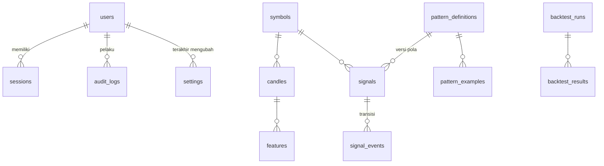

# 05 — Database

SQLite melalui `better-sqlite3`, mode WAL, `foreign_keys=ON`, `busy_timeout=5000`. Semua tabel `STRICT` (tipe kolom ditegakkan). Timestamp = `INTEGER` epoch milidetik UTC.

## 1. Migrasi

- File `backend/database/migrations/NNN_nama.sql`, nomor wajib berurutan mulai `001`.
- Tabel `schema_migrations(version, name, checksum, applied_at)` mencatat migrasi yang diterapkan.
- Setiap migrasi berjalan dalam satu transaksi — gagal di tengah berarti rollback penuh (tes `EDGE-DB-001`).
- Checksum SHA-256 migrasi yang sudah diterapkan diverifikasi setiap startup; file yang diubah setelah diterapkan menghentikan aplikasi (`NEG-DB-001`). **Perubahan skema selalu lewat migrasi baru.**
- Dijalankan otomatis saat server start dan manual via `npm run migrate`.

## 2. Diagram entitas

## 3. Tabel — 001 inti (dipakai di M1)

### `users`
| Kolom | Keterangan |
|---|---|
| `username` | Unik, `COLLATE NOCASE`, 3–32 karakter |
| `password_hash` | `CHECK` harus diawali `$argon2id$` |
| `role` | `admin` \| `analyst` |
| `totp_secret` | Disiapkan untuk MFA (M7) |
| `failed_login_count`, `locked_until` | Penguncian akun |

### `sessions`
| Kolom | Keterangan |
|---|---|
| `token_hash` | SHA-256 hex dari token cookie (token mentah tidak disimpan), unik |
| `csrf_token` | Token CSRF per sesi |
| `idle_expires_at`, `expires_at` | Kedaluwarsa idle (sliding) & absolut |
| `revoked_at`, `revoke_reason` | `logout`, `replaced`, `revoked_by_user` |

Indeks: `(user_id, revoked_at, expires_at)`, `(expires_at)`.

### `settings`
`key` (PK), `value_json` (`CHECK json_valid`), `version` (optimistic concurrency), `updated_by`, `updated_at`.

### `audit_logs`
Append-only: `occurred_at`, `user_id`, `action`, `outcome` (`success|failure`), `ip_address`, `detail_json`. Tidak pernah menyimpan kata sandi atau token. Aksi M1: `auth.login`, `auth.logout`, `auth.account_locked`, `auth.session_revoked`, `auth.sessions_revoked`, `settings.scanner.update`, `user.create`.

## 4. Tabel — 002 domain (dipakai sejak M2–M3; backtest & lab menyusul M5–M6)

| Tabel | Kunci & constraint penting |
|---|---|
| `symbols` | `symbol` unik `GLOB '[A-Z0-9]*'`; `is_monitored`; `delisted_at` untuk simbol yang dihapus Binance |
| `candles` | **PK kanonik `(symbol_id, timeframe, open_time)`**, `WITHOUT ROWID`; timeframe ∈ {5m,15m,1h}; `CHECK` konsistensi OHLC (high ≥ open/close/low, low ≤ open/close), harga > 0, volume ≥ 0, `close_time > open_time`; `is_closed`; `source` ∈ {rest, ws} |
| `features` | PK `(symbol_id, timeframe, open_time, feature_set)`, FK ke candle; `values_json` |
| `pattern_definitions` | Unik `(pattern_key, version)`; status `draft → review → validated → active → retired` |
| `pattern_examples` | Label `positive|negative`, rentang candle, waktu deteksi yang diinginkan, hash gambar, anotasi JSON |
| `signals` | Klasifikasi `SA|PVA|BOTH`; state machine 7 state; `first_detected_at`, `first_detected_price`, `pattern_definition_id` (versi), skor 0–100, alignment, risk flags & penjelasan JSON |
| `signal_events` | Setiap transisi state: `from_state`, `to_state`, `candle_time`, harga, detail |
| `backtest_runs` | Konfigurasi JSON, `data_split` (`train|validation|out_of_sample|walk_forward`), rentang waktu, `code_version` untuk reproduktibilitas |
| `backtest_results` | Per sinyal: outcome, MFE/MAE %, waktu ke breakout, regime pasar |

## 5. Tabel — 003 ingesti (M2)

| Perubahan | Keterangan |
|---|---|
| `candles.taker_buy_volume`, `taker_buy_quote_volume` | Volume taker buy dari kline Binance; baris sebelum 003 bernilai 0 |
| `symbols.monitored_since` | Kapan simbol mulai dipantau; `NULL` bila tidak dipantau. Indeks parsial `idx_symbols_monitored` |
| `provisional_candles` | Candle **belum tertutup**, satu baris terbaru per simbol × timeframe (PK `(symbol_id, timeframe)`). Tidak pernah masuk `candles` dan tidak pernah dipakai sinyal terkonfirmasi. Ditolak bila sudah ada candle tertutup untuk interval yang sama/lebih baru |
| `ingestion_runs` | Satu baris per siklus scanner/backfill: `started_at`, `finished_at`, jumlah simbol, candle, error |
| `ingestion_errors` | Error ingesti terbaru untuk System Health; pesan ≤ 500 karakter, retensi dibatasi repositori. Scanner menulis maksimal satu baris per sumber + pesan per 60 detik (`errorThrottleMs`); pesan memuat simbol & timeframe, sehingga praktis satu baris per seri per pesan per 60 detik |
| `worker_heartbeat` | Singleton (`id = 1`): `at` + `state_json` = snapshot `scanner.status()` (termasuk `clockOffsetMs` dan `clockFault`: `'OFFSET_OUT_OF_RANGE'` atau `null`). API menandai `stale` bila > 90 detik, `not_running` bila tidak ada baris |

## 6. Penyimpanan sinyal (M3)

### Tabel — 004 status analisis (`004_analysis_state.sql`)

| Perubahan | Keterangan |
|---|---|
| `analysis_cursors` | Kursor analisis per seri: PK `(symbol_id, timeframe)`, `STRICT`, `WITHOUT ROWID`; `symbol_id` FK ke `symbols` `ON DELETE CASCADE`; timeframe ∈ {5m,15m,1h}; `last_open_time` = openTime candle dasar terakhir yang **sudah dievaluasi** pipeline (termasuk candle tanpa event, mis. `NO_PATTERN`); `updated_at`. Hanya maju: upsert repositori mengabaikan nilai yang lebih lama/sama |
| `idx_signals_first_detected` | Indeks `signals(first_detected_at)` — riwayat semua sinyal `ORDER BY first_detected_at DESC, id DESC` tanpa scan penuh + sort sementara |
| `idx_signals_symbol_first_detected` | Indeks `signals(symbol_id, first_detected_at)` — riwayat per simbol dengan urutan yang sama |

Kursor dimajukan oleh `save()` (dalam transaksi yang sama dengan sinyal + event, ke `snapshot.lastCandleTime`) dan oleh `markEvaluated()` untuk candle yang tidak menyimpan apa pun. Database yang dimigrasi dari sebelum 004 mulai dengan tabel kosong; `lastEvaluatedCandleTime` lalu jatuh kembali ke candle event terakhir.

### Aturan penyimpanan

- Satu baris `signals` per sinyal hidup; state `NO_PATTERN` **tidak pernah** dipersistensi. Sinyal terminal (`INVALIDATED`, `EXPIRED`) mengisi `closed_at` dan `final_outcome`; deteksi berikutnya membuka baris baru.
- Setiap transisi state ditulis ke `signal_events` dalam **transaksi yang sama** dengan update `signals` (`save()`), sehingga riwayat tidak pernah tertinggal dari state. `save()` menolak snapshot yang mengubah state sinyal terbuka tanpa event (`STATE_CHANGE_WITHOUT_EVENT`).
- `pattern_definition_id` menunjuk versi pola (`pattern_definitions`, kunci `SA`/`PVA`, versi `PATTERN_VERSION`, `definition_json` berisi parameter, kondisi, dan warm-up). Sinyal lama tetap mereferensikan versinya.
- `explanation_json` berbentuk `{ factors: [{ factor, contribution, detail }], tracking: { lastCandleTime, lastEvaluatedAt, barsInState, peakPrice, peakState } }`. Bentuk lama (array saja) tetap dapat dibaca.
- `lastEvaluatedCandleTime` = max(`analysis_cursors.last_open_time`, MAX `signal_events.candle_time`) per simbol × timeframe dipakai pipeline sebagai titik awal replay setelah restart; candle dengan openTime ≤ nilai itu tidak dievaluasi ulang. `lastEventCandleTime` (hanya MAX `signal_events.candle_time`) tetap tersedia.

**Migrasi `005` (`005_signal_direction.sql`, Short Scanner):** menambah `signals.direction` (`'LONG'|'SHORT'`, default `'LONG'` untuk baris lama) dengan CHECK tingkat tabel yang mengikat klasifikasi (`SA`/`PVA` vs `SD`/`PVD`) dan state (`EARLY_BULLISH`/`BREAKOUT` vs `EARLY_BEARISH`/`BREAKDOWN`) ke arahnya; indeks unik parsial `idx_signals_one_open` (`symbol_id, timeframe, direction` saat `closed_at IS NULL`) = maksimal satu sinyal terbuka per seri **per arah**; `analysis_cursors` berkunci per arah. Tabel `signals`, `signal_events`, dan `analysis_cursors` dibangun ulang dalam satu transaksi (id dipertahankan; event disalin lebih dulu). Database lama yang memiliki dua sinyal terbuka untuk satu seri membuat migrasi gagal dan rollback. `pattern_definitions` kini juga memuat `SD`/`PVD` (versi `SHORT_PATTERN_VERSION`, `direction: 'SHORT'`, `mirrorOf` → `SA`/`PVA`).

**Usulan migrasi `006` (belum dibuat):** memindahkan `tracking` ke kolom sendiri (`last_candle_time`, `bars_in_state`, `peak_price`, `peak_state`) dengan indeks `(symbol_id, timeframe, last_candle_time)`, serta mengisi ulang dari `explanation_json`. Dibutuhkan sebelum M6 (backtest membaca MFE/peak dalam jumlah besar).

## 6b. Insider / Smart Money Radar (`007_smart_money.sql`)

Kontrak lengkap: `docs/15-kontrak-smart-money.md`. Semua tabel `STRICT`, ber-prefix `sm_`, timestamp INTEGER epoch ms, chain di-`CHECK` terhadap `CHAINS` (`contracts.js`). Fitur baca saja: hanya alamat publik, tidak ada kolom kunci privat. Seluruh SQL ada di `backend/smartmoney/repository.js` (`repos.smartMoney`). Alamat EVM disimpan huruf kecil; identitas token = `(chain, alamat)`, simbol hanya label. Kolom `is_simulated` menandai data fixture/demo (UI wajib menampilkan pita “DATA SIMULASI”); nilai USD `NULL` = tidak diketahui, tidak pernah diganti 0.

| Tabel | Kunci & constraint penting |
|---|---|
| `sm_wallets` | PK `(chain, address)`; `first_seen_at`, `last_activity_at`, `discovered_via` (sumber penemuan pertama dipertahankan), `discovery_reason`, `is_simulated` |
| `sm_labels` | PK `(chain, address, source, label)`; `source` wajib tidak kosong (label tanpa sumber ditolak); `category` ∈ `LABEL_CATEGORIES`; `confidence` 0..1 |
| `sm_tokens` | PK `(chain, address)`; metadata tampilan (`symbol`, `name`, `decimals`) |
| `sm_activities` | PK `id` = kunci dedupe Activity (`chain:tx:wallet:token`) → duplikat diabaikan (`INSERT OR IGNORE`); data terlambat hanya mengisi `usd_value` yang masih `NULL`. `type`/`direction`/`confidence` di-`CHECK`, `amount > 0`. Indeks `(chain, wallet, block_time)`, `(chain, token_address, block_time)`, `(block_time)` |
| `sm_wallet_scores` | PK `(chain, address)`; skor 0..100, `eligible`, `style`, `cluster_id`, komponen/metrik/alasan/keterbatasan/flag/PnL sebagai JSON |
| `sm_wallet_links` | PK `(chain, a, b, reason_type)` dengan `CHECK (a < b)`; bukti tautan JSON. Diganti per chain setiap run klaster |
| `sm_binance_map` | PK `(chain, contract_address)`; `futures_symbol` + `multiplier ≥ 1` (mis. `1000PEPEUSDT` × 1000); `source` wajib |
| `sm_watchlist` | PK `(user_id, kind, chain, address)`; `kind` ∈ `WALLET`/`TOKEN`; FK `users` `ON DELETE CASCADE` |
| `sm_alerts` | `dedupe_key` UNIK (alert ganda dalam satu ember cooldown diabaikan); `kind`/`severity` di-`CHECK` |
| `sm_alert_reads` | PK `(user_id, alert_id)`; status baca per pengguna; cascade dari `users` dan `sm_alerts` |
| `sm_alert_prefs` | PK `user_id` (cascade); `prefs_json` |
| `sm_provider_status` | PK `provider`; percobaan/sukses terakhir, `last_error_code` ∈ `PROVIDER_ERROR_CODES`, pesan ≤ 500 karakter tanpa kunci API, cakupan JSON |
| `sm_sync_cursors` | PK `(provider, chain, address)`; `address = ''` untuk kursor tingkat chain |
| `sm_evaluations` | Laporan evaluasi historis (`params_json`, `report_json`); yang terbaru dibaca `latestEvaluation()` |

## 7. Catatan presisi

OHLCV disimpan `REAL` (float64). Binance mengirim angka sebagai string desimal; float64 memberikan ±15 digit signifikan, cukup untuk rasio indikator. `tick_size`/`step_size` disimpan sebagai `TEXT` untuk mempertahankan nilai persis. Ditinjau di M2: parser kline menolak angka non-finite dan string non-desimal; indikator hanya memakai rasio sehingga galat float64 jauh di bawah ambang kondisi pola.

## 8. Backup (M8)

Rencana: `sqlite3 .backup` / API backup better-sqlite3 terjadwal, enkripsi saat diam, retensi berjenjang, dan **uji restore otomatis** (backup dianggap gagal sampai restore terverifikasi).
