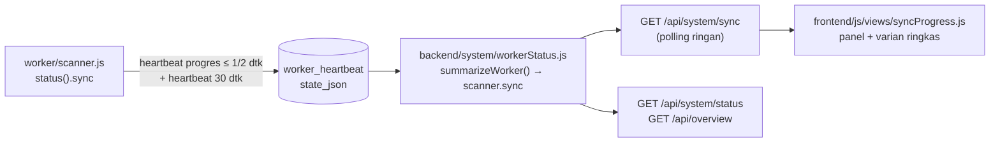

# 09 — Proses sync scanner

Satu klik **Jalankan scanner** sudah cukup: worker menyinkronkan jam, memilih simbol, mengisi histori candle, membuka stream live, lalu menganalisis setiap candle tertutup secara otomatis. Dokumen ini menjelaskan bagaimana proses itu **terlihat langsung** di website — panel **Proses sync scanner** di System Health (tepat di bawah kartu **Kontrol scanner**) dan varian ringkasnya untuk bar kontrol scanner.

Prinsip yang sama dengan seluruh aplikasi: hanya data nyata dari heartbeat worker. Nilai yang belum diketahui tampil `—`; tidak ada angka contoh, perkiraan, atau sisa waktu rekaan. Teks dari server (pesan error) selalu dirender lewat `textContent` (`h()`).

## 1. Alur data



## 2. Langkah

| Kode `sync.step` | Label UI | Yang terjadi | Selesai bila |
|---|---|---|---|
| `idle` | — | Worker belum memulai siklus (`cycle = null`), atau siklus terakhir selesai **tanpa** stream aktif (pengaturan/discovery gagal, daftar simbol kosong) | Siklus berikutnya mulai (otomatis: dicoba lagi setelah 60 detik; discovery yang gagal berulang memakai backoff) |
| `clock` | Sinkron jam | `serverClock.sync()` mengukur offset jam host terhadap `/fapi/v1/time` | Sync selesai (gagal pun dicatat sebagai error `clock`, offset terakhir dipakai) |
| `discovery` | Discovery simbol | Pengaturan dimuat; `exchangeInfo`, ticker 24 jam, dan book ticker diambil; simbol dipilih & disimpan | Simbol terpilih (`symbolsDiscovered`) atau fallback daftar DB |
| `bootstrap` | Backfill candle (REST) | Seri simbol×timeframe **baru** di-backfill REST (paralelisme 3) + perbaikan gap; WebSocket sudah dibuka untuk set stream baru, kline yang datang diantrekan per seri | Semua seri yang direncanakan selesai (berhasil atau gagal) |
| `live` | Stream live (WebSocket) → Analisis pola | Kline final dari WebSocket disimpan dan dianalisis per candle tertutup; sweep REST menambal yang tertinggal | Berlangsung terus; rediscovery berkala tiap 1 jam memulai siklus baru |
| `stopping` / `stopped` | — | `stop()`: timer & stream dihentikan, tugas aktif ditunggu, heartbeat akhir | — |

Histori hasil backfill **tidak** dianalisis (`emitBootstrap: false`): analisis pertama terjadi pada candle tertutup berikutnya, sehingga UI menampilkan "Menunggu candle tertutup berikutnya" sampai `lastAnalysisAt` terisi.

Siklus rediscovery (`cycle = 'rediscovery'`) melewati langkah `clock → discovery → bootstrap` lagi **sambil** stream yang sudah ada tetap live; hanya seri yang baru dipantau yang di-backfill (sering 0 seri).

## 3. Field

### 3.1 Worker — `scanner.status().sync`

| Field | Tipe | Arti |
|---|---|---|
| `step` | `'idle' \| 'clock' \| 'discovery' \| 'bootstrap' \| 'live' \| 'stopping' \| 'stopped'` | Langkah saat ini |
| `cycle` | `'initial' \| 'rediscovery' \| null` | Jenis siklus berjalan/terakhir; `null` sebelum siklus pertama |
| `cycleStartedAt` | epoch ms (jam host) \| `null` | Awal siklus berjalan/terakhir |
| `streamsTotal` | angka \| `null` | Seri yang direncanakan untuk backfill di siklus ini (`null` sampai rencana dibuat) |
| `streamsDone` | angka | Seri yang backfill-nya selesai (berhasil **atau** gagal) di siklus ini |
| `streamsFailed` | angka | Seri yang backfill-nya gagal (dicoba ulang oleh sweep berkala) |
| `candlesStored` | angka | Candle tertutup yang disimpan sejak siklus ini mulai — backfill REST, gap, sweep, dan stream live |
| `symbolsDiscovered` | angka \| `null` | Simbol terpilih discovery siklus ini; `null` bila discovery gagal/anomali (fallback daftar DB) |
| `lastCandleAt` | epoch ms (waktu server Binance) \| `null` | `closeTime` candle tertutup tersimpan terbaru (acuan yang sama dengan `candleLagMs`) |
| `lastAnalysisAt` | epoch ms (jam host) \| `null` | Saat callback analisis per candle terakhir selesai tanpa error |
| `updatedAt` | epoch ms (jam host) \| `null` | Perubahan progres terakhir |

Hitungan per siklus di-reset di awal setiap siklus; `lastCandleAt` dan `lastAnalysisAt` tidak. `owner` (pid/host) tetap hanya di heartbeat, tidak di `status()`.

### 3.2 API — `scanner.sync` (`summarizeWorker`)

Field sama dengan §3.1, disaring: hanya kode `step`/`cycle` yang dikenal (kode lain → `null`), angka lewat `numberOrNull`, tanpa field tambahan (owner/pid tidak pernah diteruskan). Tambahan:

- `progress` = `streamsDone / streamsTotal` (0..1) hanya bila `step === 'bootstrap'` dan `streamsTotal > 0`; selain itu `null`.
- Heartbeat tidak hidup → `step` = `'stopped'` (heartbeat akhir) atau `'stale'` (lebih tua dari 90 detik); `cycle`, `cycleStartedAt`, dan semua hitungan siklus `null` (tidak sedang berjalan); `lastCandleAt`, `lastAnalysisAt`, `updatedAt` tetap diteruskan sebagai fakta historis.
- Heartbeat hidup tanpa objek `sync` (worker versi lama) → `sync: null`. Tanpa heartbeat sama sekali → `scanner: { status: 'not_running', heartbeatAt: null, sync: null }`.

## 4. Heartbeat progres

- Selama `step` ∈ {`clock`, `discovery`, `bootstrap`}, setiap perubahan progres menjadwalkan **satu** heartbeat progres `progressHeartbeatMs` (default 2 detik) kemudian — trailing throttle: paling banyak satu tulis per 2 detik, satu baris singleton (`worker_heartbeat`, upsert), tidak pernah per candle.
- Saat `live`/`idle`/berhenti tidak ada tulis tambahan: hitungan hanya berubah di memori dan ikut heartbeat 30 detik biasa. Jadwal heartbeat progres yang tertunda dibatalkan begitu siklus selesai.
- Siklus rediscovery yang sempat menulis heartbeat progres ditutup satu heartbeat tambahan, agar UI tidak menampilkan langkah lama sampai heartbeat 30 detik berikutnya. Siklus start ditutup heartbeat yang memang ditulis `start()`.
- Siklus yang selesai kurang dari 2 detik (umum di tes dengan jam palsu) tidak menulis heartbeat tambahan sama sekali.

## 5. API — `GET /api/system/sync`

Terautentikasi seperti semua `/api/*` (tanpa sesi → 401). Satu `ingestion.getStatus()`; heartbeat yang sama dipakai ulang supervisor (tanpa query kedua), tanpa ping database, metrik memori, atau konteks pasar.

```text
{
  serverTime:   epoch ms jam server API (acuan waktu relatif di UI),
  worker:       tampilan GET /api/system/worker → { enabled, state, startedAt, stoppedAt, exitCode, signal },
  scanner:      summarizeWorker(...).scanner — termasuk sync (§3.2),
  binance:      { status, ws },
  recentErrors: maks. 5 error ingesti terbaru { id, at, source, message }
}
```

`GET /api/system/status` dan `GET /api/overview` juga memuat `scanner.sync` (field tambahan; field lama tidak berubah).

## 6. Tampilan

**Panel** `syncProgressPanel({ initial })` — stepper vertikal *Sinkron jam → Discovery simbol → Backfill candle (REST) → Stream live (WebSocket) → Analisis pola*:

| Penanda | Arti |
|---|---|
| Centang hijau (`done`) | Langkah siklus selesai |
| Cincin berputar + bar (`active`) | Langkah berjalan; bar indeterminate (`.progress-indeterminate`) untuk jam/discovery/menghubungkan WebSocket, bar determinate untuk backfill: `x / y seri · N candle · P%` |
| Titik hijau berdenyut (`live`) | Berjalan terus: WebSocket terhubung, analisis per candle |
| Abu-abu (`pending`) | Belum dimulai |

Di sampingnya: siklus, simbol dipantau, stream (basi), candle tersimpan siklus ini, candle terakhir (relatif + UTC; `closeTime` dikoreksi `clockOffsetMs` agar sebanding dengan jam host), analisis terakhir, status WebSocket, jumlah error, dan heartbeat; di bawahnya 3 error ingesti terakhir.

Mode lain: scanner tidak berjalan → empty state tenang *"Scanner tidak berjalan — tekan Jalankan scanner"* (tanpa angka); worker baru dijalankan → *menunggu heartbeat pertama* (setelah 30 detik tanpa heartbeat: peringatan untuk memeriksa log); menghentikan; heartbeat basi; worker versi lama tanpa progres sync. Supervisor didahulukan: child yang sudah keluar (`stopped`/`crashed`) berarti scanner tidak berjalan walau heartbeat terakhirnya masih tampak segar.

Aksesibilitas: wilayah `aria-live="polite"` (di luar wilayah `aria-busy`) hanya diperbarui saat langkah/mode berubah — bukan setiap polling — dan keadaan pertama setelah halaman dimuat tidak diumumkan. Langkah aktif memakai `aria-current="step"`; bar determinate memakai `role="progressbar"` + `aria-valuenow`. `prefers-reduced-motion`: cincin & bar indeterminate statis, denyut dan transisi lebar dimatikan. DOM stepper dibuat sekali dan diperbarui di tempat, sehingga animasi tidak terulang setiap polling.

## 7. Cadence polling

Semua tampilan di satu halaman berbagi **satu** poller `GET /api/system/sync` dengan `{ background: true }` (header `X-LR-Background: 1`, tidak memperpanjang idle timeout sesi). `setTimeout` berantai, bukan `setInterval`.

| Keadaan | Jeda |
|---|---|
| Worker `starting`, menunggu heartbeat pertama (≤ 30 detik sejak dijalankan), sinkron jam / discovery / backfill, menyiapkan siklus pertama, menghentikan, memuat | 2 detik |
| 20 detik setelah `requestSyncRefresh()` (tombol kontrol ditekan) | 2 detik (polling pertama ±1 detik) |
| Live, tidak berjalan, heartbeat basi, worker versi lama, menunggu heartbeat > 30 detik | 10 detik |

Polling berhenti sendiri saat elemen dilepas dari halaman (`el.isConnected` diperiksa di setiap timer; elemen yang tidak pernah terpasang dalam 5 detik dianggap view basi). Error jaringan diabaikan — indikator koneksi topbar yang menampilkannya — dan state terakhir tetap tampil.

## 8. Menyematkan varian ringkas di bar kontrol scanner

`syncProgressInline({ initial })` merender satu baris: badge langkah + bar kecil + `x/y seri` selama backfill, atau `Live · candle terakhir … lalu` saat live. Tanpa wilayah aria-live (pengumuman milik panel lengkap). `initial` opsional: payload `GET /api/system/sync` atau `GET /api/system/status`; tanpa itu status dimuat segera.

Dari modul di `frontend/js/views/` (mis. bar kontrol scanner):

```js
import { requestSyncRefresh, syncProgressInline } from './syncProgress.js';

// Di samping tombol Jalankan/Hentikan scanner (elemen <div class="sync-inline">):
const syncLine = syncProgressInline({ initial: null });
buttonsRow.append(syncLine);

// Setelah POST /api/system/worker/start atau /stop berhasil: langkah pertama langsung terlihat.
requestSyncRefresh();
```

Dari `frontend/js/app.js` atau `frontend/js/lib/`: `import { requestSyncRefresh, syncProgressInline } from './views/syncProgress.js';` / `'../views/syncProgress.js'`.

Elemen yang tetap terpasang (bar persisten) terus memantau: 10 detik saat diam/live, 2 detik selama sync. Melepasnya dari DOM menghentikan polling tanpa cleanup tambahan. System Health memanggil `requestSyncRefresh()` untuk setiap klik tombol di kartu Kontrol scanner (event delegation di `health.js`, tanpa mengubah `workerControl.js`).

## 9. Keterbatasan

- Granularitas progres backfill = seri simbol×timeframe, bukan request; satu seri dengan 500 candle tercatat sekaligus saat selesai.
- Jeda tampil ≈ heartbeat progres (≤ 2 detik) + polling (≤ 2 detik).
- Tidak ada perkiraan sisa waktu: durasi bergantung pada limiter bobot & backoff Binance, sehingga angka ETA akan menjadi rekaan.
